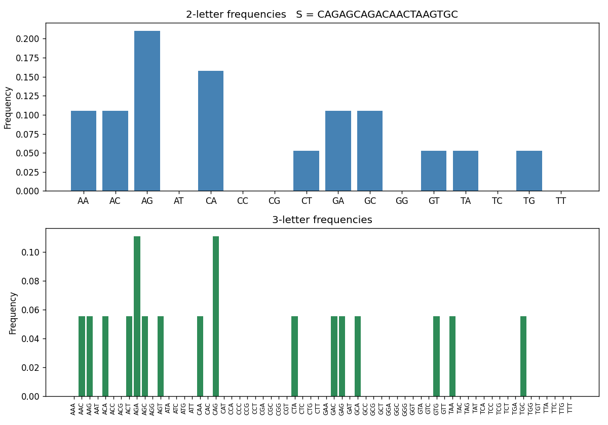

# Lab 01 - DNA Sequence Analysis

Counting the bases of a DNA sequence and the 2-letter and 3-letter combinations in it.

| File | What it does |
|---|---|
| `task1.py` | Counts A, C, G, T in a fixed sequence and prints count and frequency |
| `task1-1.py` | Same count on a random 20-letter sequence |
| `task2.py` | Counts all 16 two-letter and 64 three-letter combinations and draws bar charts |

## How it works

- **Frequency** of a base = its count / length of the sequence. The four frequencies add up to 100%.
- **Combinations**: all 4^2 = 16 pairs and 4^3 = 64 triples are listed first with count 0, so ones that never appear are still shown.
- A window of k letters slides along the sequence one step at a time. A sequence of length n has n - k + 1 windows (19 pairs, 18 triples for n = 20). Frequency = count / number of windows.

## Run

```
pip install matplotlib
python task1.py
python task1-1.py
python task2.py
```

`task1-1.py` and `task2.py` give a different random sequence each run. Add a number to repeat a run, e.g. `python task2.py 7`.

## Output

### task1.py

```
S = ATGCGATACGCTTAGGCTAA
Length: 20
A: count= 6  freq=0.30 (30%)
C: count= 4  freq=0.20 (20%)
G: count= 5  freq=0.25 (25%)
T: count= 5  freq=0.25 (25%)
Total: 20 letters = 100%
```

### task1-1.py (seed 7)

```
S = CAGAGCAGACAACTAAGTGC
Length: 20
A: count= 8  freq=0.40 (40%)
C: count= 5  freq=0.25 (25%)
G: count= 5  freq=0.25 (25%)
T: count= 2  freq=0.10 (10%)
```

### task2.py (seed 7)

```
S = CAGAGCAGACAACTAAGTGC

2-letter combinations (16 combinations, 19 windows)
  AA: count=2  freq=0.105
  AC: count=2  freq=0.105
  AG: count=4  freq=0.211
  AT: count=0  freq=0.000
  CA: count=3  freq=0.158
  CC: count=0  freq=0.000
  CG: count=0  freq=0.000
  CT: count=1  freq=0.053
  GA: count=2  freq=0.105
  GC: count=2  freq=0.105
  GG: count=0  freq=0.000
  GT: count=1  freq=0.053
  TA: count=1  freq=0.053
  TC: count=0  freq=0.000
  TG: count=1  freq=0.053
  TT: count=0  freq=0.000

3-letter combinations (64 combinations, 18 windows)
  AAA: count=0  freq=0.000
  AAC: count=1  freq=0.056
  AAG: count=1  freq=0.056
  AAT: count=0  freq=0.000
  ACA: count=1  freq=0.056
  ACC: count=0  freq=0.000
  ACG: count=0  freq=0.000
  ACT: count=1  freq=0.056
  ...
```

Chart saved by `task2.py`:



With only 20 letters most 3-letter counts are 0 or 1. A longer sequence gives smoother charts.
