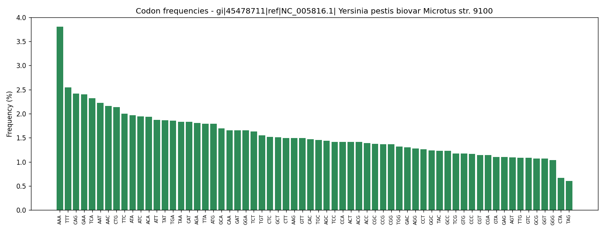
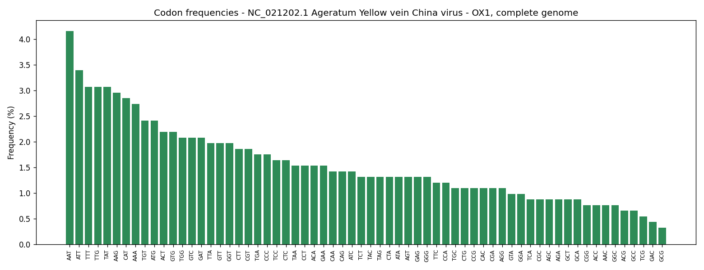

# Lab 03 - Genome and Codon Analysis

Counting how often each codon appears in a real genome read from a FASTA file.

| File | What it does |
|---|---|
| `codon_frequency.py` | Reads a FASTA file (plain or `.gz`), counts the 64 codons, prints the top ones and saves a bar chart |
| `genomes/NC_005816.fasta` | *Yersinia pestis* plasmid pPCP1 (9,609 nt) |
| `genomes/GCF_000907355.1_ViralProj202889_genomic.fna.gz` | Ageratum yellow vein China virus (2,739 nt) |

Both genomes are public sequences from NCBI.

## How it works

- **FASTA**: the line starting with `>` is the genome name; the other lines are the DNA and are joined into one string. `.gz` files are unzipped while reading.
- **64 counters**: 4 x 4 x 4 codons are listed first with count 0, so codons that never appear are still reported.
- **Sliding window**: a window of 3 letters moves one step at a time and adds 1 to the codon inside. A genome of n letters has n - 2 windows. With `--frame 1`, `2` or `3` the window jumps 3 letters, so only the codons of one reading frame are counted (about n / 3).
- **Frequency** = count / number of codons counted; all 64 add up to 100%.
- **Sorting** from most to least frequent gives the top list. Different organisms prefer different codons ("codon usage bias"), so the table works like a fingerprint of a genome.
- Windows containing letters other than A, C, G, T (for example N) are skipped.

## Run

```
pip install matplotlib
python codon_frequency.py genomes/NC_005816.fasta
python codon_frequency.py genomes/GCF_000907355.1_ViralProj202889_genomic.fna.gz --top 5 --frame 1
```

Options: `--top N` (how many codons to list), `--frame 0|1|2|3`, `--no-plot`.

## Output

### Plasmid, all windows

```
Genome : gi|45478711|ref|NC_005816.1| Yersinia pestis biovar Microtus str. 91001 plasmid pPCP1, complete sequence
Length : 9,609 nt
GC     : 45.26%
Codons : 9,607 counted (all windows)

Top 10 codons
Rank  Codon  AA   Count   Freq %  Bar
----------------------------------------------------
1     AAA    K      366    3.81%  #########################
2     TTT    F      245    2.55%  #################
3     CAG    Q      232    2.41%  ################
4     GAA    E      231    2.40%  ################
5     TCA    S      223    2.32%  ###############
6     AAT    N      214    2.23%  ###############
7     AAC    N      208    2.17%  ##############
8     CTG    L      205    2.13%  ##############
9     TTC    F      192    2.00%  #############
10    ATA    I      189    1.97%  #############

Codons that never appear: 0
Chart saved: NC_005816_codons.png
```



### Virus, reading frame 1, top 5

```
Genome : NC_021202.1 Ageratum Yellow vein China virus - OX1, complete genome
Length : 2,739 nt
GC     : 41.44%
Codons : 913 counted (reading frame 1)

Top 5 codons
Rank  Codon  AA   Count   Freq %  Bar
----------------------------------------------------
1     AAT    N       38    4.16%  #########################
2     ATT    I       31    3.40%  ####################
3     TTT    F       28    3.07%  ##################
4     TTG    L       28    3.07%  ##################
5     TAT    Y       28    3.07%  ##################

Codons that never appear: 0
Chart saved: GCF_000907355_codons.png
```



The most common codon in the plasmid is AAA (Lys) with 3.81%, and its GC content is 45.26%.
