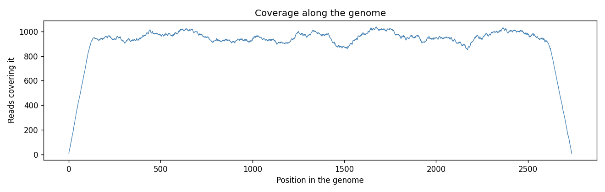

# Lab 04 - Genome Assembly

Cut a genome into 20,000 random pieces (reads) of 100-150 nucleotides, then forget the genome and rebuild it only from the pieces.

| File | What it does |
|---|---|
| `genome_assembly.py` | Takes the random reads, checks coverage, rebuilds the genome from overlaps and compares it with the original |
| `genomes/` | The two genomes used (public sequences from NCBI) |
| `coverage.png` | How many reads cover each position |

## How it works

1. **Reads**: a random length (100-150) and a random start; the piece in that window is copied. This is done 20,000 times, like a sequencing machine.
2. **Coverage**: how many reads cover each position. 20,000 reads x about 125 letters / 2,739 letters is about 900x on average, so every letter is read many times. A position with coverage 0 can not be rebuilt.
3. **Overlap**: two reads that sit next to each other share letters: the end of the first is the start of the second.

```
contig: ...ACGTTAGGCATCCGA
read  :          GGCATCCGATTACG     overlap = GGCATCCGA
result: ...ACGTTAGGCATCCGATTACG     only the new letters are added
```

4. **Greedy assembly**: start from the longest read. Find reads whose first letters equal the end of the contig (overlap of at least 30 letters), add the one that brings the most new letters, repeat until none fits. The left side is done the same way on the reversed text.
5. **Fast lookup**: reads are stored in a dictionary under their first 30 letters, so a read is found directly instead of comparing 20,000 x 20,000 pairs.
6. **Gaps**: if part of the genome was never read, the contig stops at the gap and a new contig is started from a read not used yet. Several contigs = missing parts.
7. **Check**: the longest contig is compared with the original.

An overlap of 30 letters is only safe if that piece appears once in the genome. In these small genomes it does, so every overlap points to one place. Genomes with long repeats are much harder to assemble.

## Run

```
pip install matplotlib
python genome_assembly.py
python genome_assembly.py genomes/NC_005816.fasta
python genome_assembly.py --reads 60
```

Options: `--reads`, `--min`, `--max`, `--overlap`, `--seed`, `--no-plot`. The same seed always gives the same reads.

## Output

### 20,000 reads (the task)

```
Genome : NC_021202.1 Ageratum Yellow vein China virus - OX1, complete genome
Length : 2,739 nt

1. Reads
   Taken            : 20,000 reads of 100-150 nt (average 125.0)
   Expected coverage: 912x  (reads x average length / genome length)
   Real coverage    : min 5x, max 1039x, mean 912x
   Never read       : 0 positions

2. Assembly
   Different reads  : 18,584 (identical ones merged)
   Contigs          : 1  (one complete piece)
   Glue steps       : 23
   Time             : 0.08 s

3. Result
   Original length  : 2,739 nt
   Rebuilt length   : 2,739 nt
   Match            : 100% identical, the genome was rebuilt perfectly
   Original start   : ACCGGATGGCCGCGATTTTTTTTAAAGTGGTCACCACCACTAACAAATGT
   Rebuilt start    : ACCGGATGGCCGCGATTTTTTTTAAAGTGGTCACCACCACTAACAAATGT
```



### Too few reads (60): gaps appear

With only about 3x coverage, 162 positions were never read, so the genome falls apart into 9 contigs and the longest one covers only part of it.

```
Genome : NC_021202.1 Ageratum Yellow vein China virus - OX1, complete genome
Length : 2,739 nt

1. Reads
   Taken            : 60 reads of 100-150 nt (average 123.5)
   Expected coverage: 3x  (reads x average length / genome length)
   Real coverage    : min 0x, max 8x, mean 3x
   Never read       : 162 positions

2. Assembly
   Different reads  : 60 (identical ones merged)
   Contigs          : 9  (gaps: some parts were never read)
   Contig lengths   : 804, 551, 416, 232, 148, 147, 127, 117, 113
   Glue steps       : 20
   Time             : 0.00 s

3. Result
   Original length  : 2,739 nt
   Rebuilt length   : 804 nt (longest contig)
   Match            : 29.35% of the original
   Original start   : ACCGGATGGCCGCGATTTTTTTTAAAGTGGTCACCACCACTAACAAATGT
   Rebuilt start    : GGGCAGTATGCGTCTAAAGAACAGGCATTGGTGAAGAAGTTCATGCGGGT
```

### Bigger genome (plasmid, 9,609 nt)

```
Genome : gi|45478711|ref|NC_005816.1| Yersinia pestis biovar Microtus str. 91001 plasmid pPCP1, complete sequence
Length : 9,609 nt


2. Assembly
   Different reads  : 19,599 (identical ones merged)
   Contigs          : 1  (one complete piece)
   Glue steps       : 83
   Time             : 0.17 s

3. Result
   Original length  : 9,609 nt
   Rebuilt length   : 9,609 nt
   Match            : 100% identical, the genome was rebuilt perfectly
   Original start   : TGTAACGAACGGTGCAATAGTGATCCACACCCAACGCCTGAAATCAGATC
   Rebuilt start    : TGTAACGAACGGTGCAATAGTGATCCACACCCAACGCCTGAAATCAGATC
```
